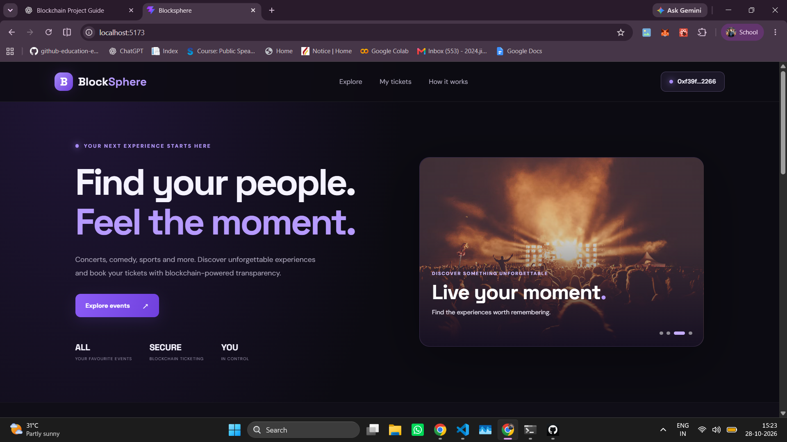
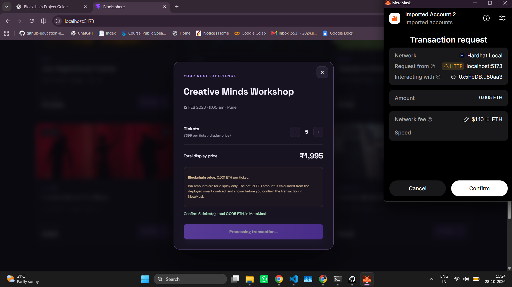

# BlockSphere

A blockchain-based event ticket booking prototype built with React and Solidity. The frontend is hosted on Vercel and connects MetaMask to an Ethereum Sepolia smart contract for event discovery, ticket booking, cancellation, refunds, and organizer withdrawals.

> **Project status:** Academic prototype in active development. The frontend is configured for Sepolia (chain ID `11155111`). This is a testnet demonstration, not a production ticketing or payment service. Sepolia uses test ETH, which has no intended real-world value.

## Overview

BlockSphere explores how a web application can use a smart contract to manage ticket inventory and payments. Users can browse sample events, select ticket quantities, connect MetaMask, and submit transactions to the booking contract.

## Features

### Frontend
- Browse, search, and filter sample event listings.
- Select an event and ticket quantity.
- Connect MetaMask and check that the wallet is on Sepolia.
- Check that contract bytecode exists at the configured address before enabling contract interaction.
- Submit booking transactions and wait for a successful transaction receipt before showing confirmation.
- View tickets associated with the connected wallet and request cancellation.

### Smart contract
The `EventTicketBooking.sol` contract includes:
- Event creation with a future date, ticket price, and ticket supply.
- Single-ticket and multi-ticket booking.
- Exact-payment validation and inventory checks.
- Ticket cancellation and refunds before the event.
- Organizer withdrawals after the event.
- On-chain event and ticket state tracking.

## Screenshots

### Event listing


### Booking preview


### Transaction result


## Technology stack

| Technology | Role |
|---|---|
| React 19 + Vite | Frontend application and development server |
| JavaScript, HTML, CSS | Application logic and interface |
| Solidity | Ticket booking smart contract |
| Hardhat 2 + Hardhat Toolbox | Contract compilation, deployment, and tests |
| ethers.js 6 | Contract and wallet interaction |
| MetaMask | Browser wallet connection and transaction approval |
| Vercel | Frontend hosting |

## Architecture

```text
User
  |
  v
React + Vite frontend (Vercel)
  |
  v
MetaMask wallet (Sepolia)
  |
  v
ethers.js
  |
  v
EventTicketBooking.sol (Sepolia)
  |
  v
Transaction receipt and UI confirmation
```

## Repository structure

```text
BlockSphere/
├── frontend/
│   ├── src/
│   │   ├── App.jsx
│   │   ├── App.css
│   │   └── contract.js
│   └── package.json
├── blockchain/
│   ├── contracts/
│   │   └── EventTicketBooking.sol
│   ├── scripts/
│   │   └── deploy.js
│   ├── test/
│   │   └── EventTicketBooking.js
│   └── hardhat.config.js
└── ss/
```

## Run locally

### Prerequisites
- Node.js and npm
- Git
- MetaMask browser extension
- Sepolia test ETH for testnet transactions

### 1. Clone the repository

```bash
git clone https://github.com/Jitin7Coder/BlockSphere.git
cd BlockSphere
```

### 2. Install dependencies and compile the contract

```bash
cd blockchain
npm install
npx hardhat compile
```

### 3. Run the smart contract tests

From the `blockchain` directory:

```bash
npx hardhat test
```

The test suite covers event creation, single-ticket booking, multi-ticket booking, incorrect payments, insufficient inventory, cancellation and refunds, ticket ownership, and organizer withdrawals. Tests run against Hardhat's local in-memory network; they do not send transactions to Sepolia.

### 4. Configure Sepolia deployment credentials

Create a `.env` file inside `blockchain/` (it must remain untracked) with:

```env
SEPOLIA_RPC_URL=your_sepolia_rpc_url
PRIVATE_KEY=your_deployment_wallet_private_key
```

Use a dedicated wallet containing only Sepolia test ETH. Never commit this file, a private key, or a seed phrase. The Hardhat configuration reads these two environment variables for the Sepolia network.

### 5. Deploy the contract and create sample events

From the `blockchain` directory:

```bash
npx hardhat run scripts/deploy.js --network sepolia
```

The script deploys `EventTicketBooking.sol`, creates the sample events, and prints the deployed contract address. Deployment requires a working Sepolia RPC endpoint and sufficient Sepolia test ETH.

After deployment:
1. Copy the printed contract address.
2. Update `CONTRACT_ADDRESS` in `frontend/src/contract.js` to that address.
3. Ensure `frontend/src/contractABI.json` matches the ABI generated from the deployed contract artifact.
4. Commit only the public contract address and ABI; do not commit secrets.
5. Deploy the updated frontend to Vercel.

**Important:** The frontend address currently configured in the repository is `0xce27CCa4605834b1C939A64BFC3229483761cc86`. Confirm that this address contains the expected contract on Sepolia before relying on it. A configured address alone is not proof of a successful deployment.

### 6. Start the frontend

In a separate terminal:

```bash
cd frontend
npm install
npm run dev
```

Open the local URL printed by Vite. Connect MetaMask to Sepolia (chain ID `11155111`). The frontend checks the selected chain and verifies that contract bytecode exists at the configured address.

## Test and deployment evidence

Automated contract tests use Hardhat's local in-memory network. The repository also contains a deployment script intended for Sepolia. The configured frontend address and network check indicate Sepolia integration, but deployment status and transaction history should be confirmed independently using a Sepolia block explorer.

Do not interpret local Hardhat test results as proof of a public testnet deployment.

## Scope and limitations

- Academic prototype in active development; not a production ticketing platform.
- Sepolia is a public test network; transactions require test ETH and are not real payments.
- Event listings are sample frontend data and must correspond to events created on-chain.
- The frontend currently uses a configured contract address rather than dynamically discovering deployments.
- Mobile usability, broader end-to-end coverage, and production-grade security review remain areas for improvement.

## Planned improvements

- Add automated frontend and end-to-end tests.
- Add contract verification and a reproducible deployment record.
- Improve event data synchronization between the frontend and contract.
- Improve mobile usability and ticket lifecycle handling.
- Conduct a security review before considering any production deployment.

## Author

**Jitin Jadwani** — [GitHub profile](https://github.com/Jitin7Coder)

---

If you explore the project, feedback and issue reports are welcome.
