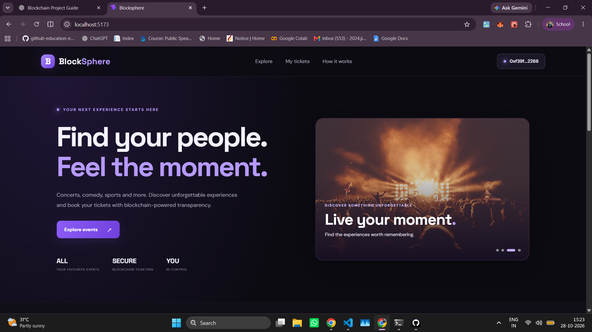
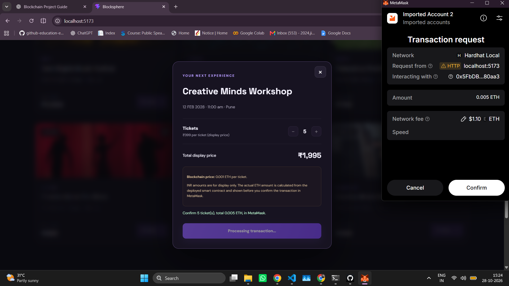
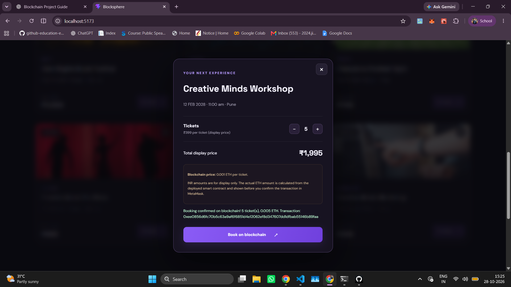

# BlockSphere — Blockchain-Based Event Ticket Booking

BlockSphere is an academic prototype that demonstrates how an event-ticket booking interface can interact with an Ethereum-compatible smart contract through MetaMask and verify a booking transaction on a local blockchain.

> **Project status:** Local development prototype. The documented booking test was performed on Hardhat Local; this repository does not represent a public blockchain deployment.

## Features

- Browse sample events through a React interface.
- Search and filter event listings.
- Select an event and ticket quantity, then review a booking preview.
- Connect a wallet using MetaMask.
- Submit a booking transaction to the `EventTicketBooking.sol` smart contract.
- Wait for the transaction receipt and check its status before showing confirmation.

## Tech Stack

| Technology | Purpose |
|---|---|
| React + Vite | Frontend interface and development/build workflow |
| JavaScript, HTML, CSS | UI behaviour and styling |
| Solidity | Smart-contract logic |
| Hardhat | Contract compilation, deployment tools, tests, and local development network |
| MetaMask | Wallet connection and transaction approval |
| ethers.js | Frontend communication with the contract and provider |

## Architecture

## Application Screenshots

### Homepage


### Ticket Booking Preview


### Booking Confirmation



```text
User
  |
  v
React + Vite frontend
  |
  v
MetaMask wallet approval
  |
  v
Hardhat Local network
  |
  v
EventTicketBooking.sol
  |
  v
Transaction receipt checked by frontend
```

## Repository Structure

```text
BlockSphere/
├── frontend/              # React + Vite application
│   ├── src/
│   │   ├── App.jsx
│   │   ├── App.css
│   │   └── contract.js
│   ├── package.json
│   └── ...
├── blockchain/            # Hardhat project
│   ├── contracts/
│   │   └── EventTicketBooking.sol
│   ├── scripts/
│   ├── test/
│   ├── hardhat.config.js
│   └── package.json
└── README.md
```

## Run Locally

### Prerequisites

- Node.js and npm
- Git
- MetaMask browser extension

### 1. Clone the repository

```bash
git clone https://github.com/Jitin7Coder/BlockSphere.git
cd BlockSphere
```

### 2. Install blockchain dependencies

```bash
cd blockchain
npm install
```

### 3. Start the local Hardhat node

Open a terminal in the `blockchain` directory and run:

```bash
npx hardhat node
```

Keep this terminal running. The local node normally uses `http://127.0.0.1:8545` and chain ID `31337`.

### 4. Compile and deploy the contract

Open a **second terminal** in the `blockchain` directory:

```bash
npx hardhat compile
npx hardhat run scripts/deploy.js --network localhost
```

Use the deployed contract address in the frontend configuration. The frontend contract address, ABI, wallet network, and RPC endpoint must match the local deployment.

### 5. Install and start the frontend

Open a **third terminal**:

```bash
cd frontend
npm install
npm run dev
```

Open the local URL printed by Vite in your browser. Connect MetaMask to the local Hardhat network and use a local development account for testing only.

> **Important:** Hardhat's local accounts and private keys are for local development only. Never use them for real funds, and never commit private keys, seed phrases, or `.env` secrets to GitHub.

## Test Evidence

A booking test was recorded with the following details:

- **Event:** Champions Football Night
- **Quantity:** 1 ticket
- **Transaction value:** 0.003 ETH
- **Network:** Hardhat Local
- **Chain ID:** `31337`
- **Receipt status:** `1` (successful execution)
- **Block:** `12`

This confirms the observed transaction on the local development chain only. It does not indicate deployment to Ethereum mainnet or a public testnet.

## Current Scope and Limitations

This prototype demonstrates event discovery and the wallet-to-contract booking transaction flow. It is not a production ticketing platform. Complete NFT ticket issuance, public testnet deployment, public hosting, venue-entry validation, and comprehensive end-to-end testing are not claimed as completed features.

## Future Improvements

- Deploy and verify the contract on a public testnet.
- Host the frontend so it can be accessed remotely.
- Add a complete NFT ticket issuance and ownership workflow.
- Expand tests for invalid bookings, payment errors, rejected wallet requests, and other failure cases.
- Improve mobile usability and ticket lifecycle handling.

## Author

**Jitin7Coder** — [GitHub Profile](https://github.com/Jitin7Coder)

---

If you find this project useful, feel free to explore the code and open an issue with feedback.
